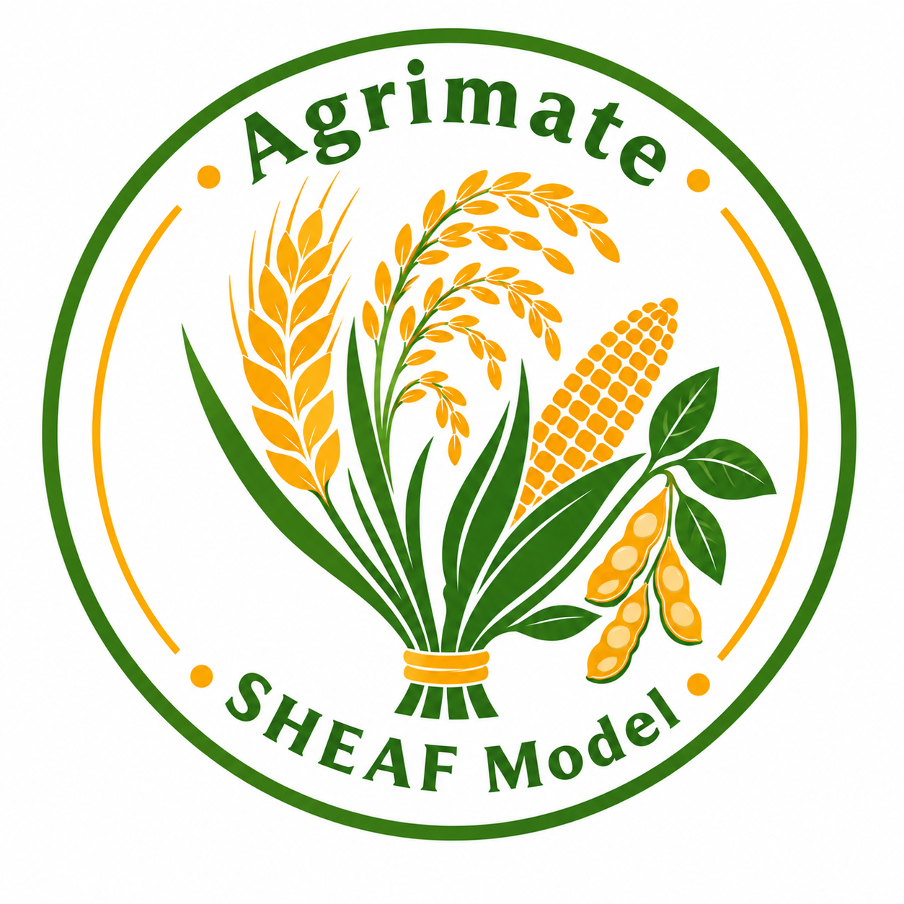
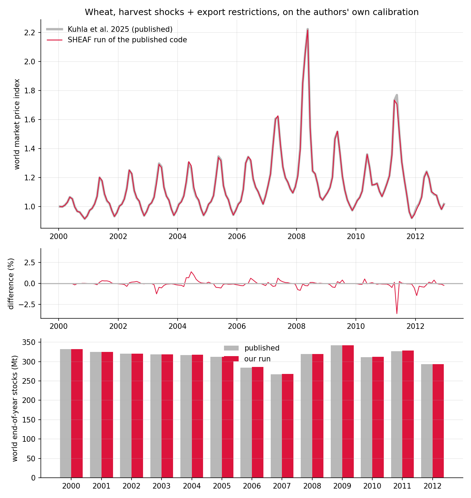

# Agrimate-SHEAF

<p align="center">
  
</p>

The **Agrimate-SHEAF** model is the published Agrimate market
(Kuhla, Kubiczek, and Otto 2025) plus two extensions built **in
that code**. Agrimate already does storage and the trade network. SHEAF
adds what a single-crop model still omits:

1. **Substitution (Gate 1).** Wheat, rice, and maize linked on the demand
   side. Design: [`diagnostics/GATE1_DESIGN.md`](diagnostics/GATE1_DESIGN.md).
2. **Strategy (Gate 2).** An endogenous export-restriction game among
   governments, on Agrimate’s 24-step clock
   ([`diagnostics/GAME_CLOCK.md`](diagnostics/GAME_CLOCK.md)). Blocked
   until Gate 1 is accepted.

> **sheaf** &nbsp;/ʃiːf/&nbsp; — a bundle of cereal stalks; in mathematics,
> locally defined data glued into a coherent whole.
> **S**ubstitution, **H**eterogeneous agents, **E**quilibrium, **A**nd
> **F**ragility.

Gate 0 is both switches off (AMIS diary, one crop). Wheat Gate 0 is
**accepted** (G0-P). Rice and maize `t_max=0` smoke is **met**. Gate 1
coding has started (`ξ` default 0). Coauthor questions in
`GATE1_DESIGN.md` §8 stay open.

Gate 2's decision rule blends a reactive (threshold and cascade) term with
a myopic best-response term, with Nash equilibrium as a nested limit and
no new stockholder: Agrimate's purchaser already holds strategic stocks.
See [`diagnostics/GATE2_FOUNDATIONS.md`](diagnostics/GATE2_FOUNDATIONS.md).

The accepted wheat Gate 0 was run on the **published Julia Agrimate code**,
vendored at [`agrimate_julia/`](agrimate_julia/) (Kuhla, Kubiczek, and Otto
2025; Zenodo [10.5281/zenodo.14022004](https://doi.org/10.5281/zenodo.14022004);
CC-BY 4.0). Current four-crop runs use a separate PIK checkout. Both are
in [How to run](#3-how-to-run). Python here is drivers, input generation,
scoring, and plots.

## Gate 0 status

The published code, given the authors’ own calibration, **reproduces their
published wheat run**
([`diagnostics/gate0_julia/J10_authorbaseline.md`](diagnostics/gate0_julia/J10_authorbaseline.md)).
The 2007/08 world-price ratio is 1.359 against their 1.361, 2010/11 is 1.213
against 1.219, the May 2008 peak is 2.216 against 2.223, monthly prices
correlate at 1.000, and end-of-year stocks are within 0.5 % every year
2000–2012.



*Wheat, harvest shocks plus export restrictions, on the authors’ own
calibration. Grey is the published NetCDF; red is our run of the published
code. The authors did not publish their input tables; J10 inverts their
output arrays back into the CSVs the code reads. That is a verification of
the code path. Reconstructing those tables from USDA / FAOSTAT / AMIS (J4,
J8, J9) ran the same code and did **not** reproduce the published
magnitudes — stocks +23 %, 2007/08 ratio 1.25 versus 1.36 — so public-data
reproducibility remains an open limitation.*

Wheat Gate 0 is **accepted** (G0-P, 2026-10-07). Rice and maize smoke is
**met**. Next is Gate 1 substitution in this host, per
[`diagnostics/GATE1_DESIGN.md`](diagnostics/GATE1_DESIGN.md)
([`diagnostics/DEVELOPMENT.md`](diagnostics/DEVELOPMENT.md)).

## Cite

Kuhla, K., Kubiczek, P., & Otto, C. (2025). Understanding agricultural
market dynamics in times of crisis: The dynamic agent-based network model
Agrimate. *Ecological Economics*, 231, 108546.
https://doi.org/10.1016/j.ecolecon.2025.108546

Source snapshot used here: Kuhla, K., & Kubiczek, P. (2024), Zenodo
[10.5281/zenodo.14022004](https://doi.org/10.5281/zenodo.14022004), folder
`agrimate-equal-sales-penalty`, CC-BY 4.0. SHA-256 of the zip is in
[`agrimate_julia/UPSTREAM.md`](agrimate_julia/UPSTREAM.md). Every Agrimate-SHEAF edit
to that source is listed there.

## Layout

This repository **is** the working tree: Agrimate-SHEAF. Clone it and you
have the model. We build from `agrimate_julia/` — the published Agrimate
source, and the file Gate 1 will edit. There is no second copy to
download.

```
agrimate_julia/        THE MODEL (edit here; list changes in UPSTREAM.md)
  src/simulation.jl    entry: simulate(params; …)
  src/preprocess.jl    CSVs → baseline
  src/AgrimateModel/   agents, Nash, dynamics
drivers/run.py         launch (wheat / rice / maize)
drivers/score.py       score a wheat NetCDF vs the author file
inputs/from_data.py    write the seven CSVs from USDA / FAOSTAT / AMIS
inputs/from_paper.py   J10 invert of the author wheat NetCDF (not portable)
inputs/pipelines/      readers those builders call
data/                  raw tables (PSD, E0, calendars, AMIS)
diagnostics/           contract, GATE1_DESIGN.md, J0–J10 evidence
plots/  figures/       J10 figure
```

Generated CSVs (`inputs/generated/`) and Julia NetCDFs
(`agrimate_julia/data/`) are gitignored. They are products, not source.

## Requirements (Mac and Windows)

The Agrimate **source** is already in this repo: [`agrimate_julia/`](agrimate_julia/)
(Zenodo 14022004, CC-BY 4.0). Clone SHEAF and you have it. Do not download
that tree again from Zenodo or GitLab. Gate 1 edits (substitution) go in
this copy; list each one in [`agrimate_julia/UPSTREAM.md`](agrimate_julia/UPSTREAM.md).

What you still install locally is the **Julia 1.6.5 interpreter** — the
language binary, like `python` itself. That is not in GitHub (a Mac `.dmg`
does not run on Windows). Do not install a current Julia. Do not run
`Pkg.update()` or `Pkg.resolve()` — `agrimate_julia/Manifest.toml` pins
the package versions that produced the J10 match.

**Julia 1.6.5 interpreter** (old releases: [julialang.org/downloads/oldreleases](https://julialang.org/downloads/oldreleases/))

| Platform | Installer | How `drivers/run.py` invokes it |
|---|---|---|
| macOS Intel | `julia-1.6.5-mac64.dmg` | `julia --project=agrimate_julia` |
| macOS Apple Silicon | same **Intel** `.dmg`, run under Rosetta | wraps `arch -x86_64` for you |
| Windows 64-bit | `julia-1.6.5-win64.exe` | `julia.exe --project=agrimate_julia` (no Rosetta) |

Point the drivers at the binary if it is not the default Mac path:

```bash
# macOS / Linux / Git Bash
export AGRIMATE_JULIA=/path/to/julia-1.6.5/bin/julia

# Windows PowerShell
$env:AGRIMATE_JULIA="C:\Julia-1.6.5\bin\julia.exe"

# Windows cmd
set AGRIMATE_JULIA=C:\Julia-1.6.5\bin\julia.exe
```

First time only, instantiate the pinned project (this downloads the
Manifest packages; it does not change versions):

```bash
# macOS / Linux / Git Bash
cd agrimate_julia
"$AGRIMATE_JULIA" --project=. -e 'using Pkg; Pkg.instantiate()'

# Windows PowerShell
cd agrimate_julia
& $env:AGRIMATE_JULIA --project=. -e 'using Pkg; Pkg.instantiate()'

# Windows cmd
cd agrimate_julia
"%AGRIMATE_JULIA%" --project=. -e "using Pkg; Pkg.instantiate()"
```

Python deps:

```bash
python -m pip install -r requirements.txt
```

On Windows, `python` / `py` is fine. On all platforms, run the builders
from the repo root so `PYTHONPATH=.` finds `inputs/pipelines/`.

## 1. Input file creation

`simulate()` does not read USDA or FAOSTAT. It reads **seven CSVs** in one
directory. Python writes those files; Julia (`agrimate_julia/src/preprocess.jl`)
turns them into the baseline. Quantities are **thousand tonnes**. The
world-price index is dimensionless and sits near 1.

| CSV (name contains `crop=<wheat\|rice\|maize>`) | What it is |
|---|---|
| `food-balance_baseline=2007-2009_crop=….csv` | Production, consumption, exports, imports per ISO country |
| `trade-flows_baseline=2007-2009_crop=….csv` | Bilateral `Origin, Destination, Trade Flow` |
| `harvest-distributions_crop=….csv` | 365 daily harvest shares (rows sum to 1) |
| `harvest-anomalies_crop=…_source=FAOsince-2005.csv` | Daily anomaly; 0 before 2005 and wherever the trend is 0 |
| `harvest-trends_crop=…_source=FAOsince-2005.csv` | Daily LOWESS trend. Forcing is `1 + anomaly/trend` |
| `parameters_baseline=2007-2009_crop=…_source=empirical.csv` | Country `STU`, `A_d`, `A_c` (see Calibration) |
| `export-restrictions_crop=…_source=2007-2011.csv` | `Exporter, From, To, Value` (fraction of foreign sales cut) |

Default output directory: `inputs/generated/agrimate_input/` (gitignored).
Several crops can share that folder; the crop is in the filename.

### Public-data inputs (portable; wheat, rice, or maize)

This is the builder to use on a new machine. It does **not** reproduce the
published wheat magnitudes (J4/J8/J9). It is a valid Agrimate run on USDA /
FAOSTAT / AMIS.

Sources, all under `data/`:

- USDA PSD country-year (`data/usda_psd/`), baseline mean **2007–2009**
- FAOSTAT E0 trade, window **2006–2007**, each exporter rescaled to its USDA export total
- harvest calendars in `data/crop_calendars/<crop>_harvest_months.csv` (raised cosine over the harvest months)
- AMIS measures, clipped to **2007-01-01 … 2011-12-31**, overlapping rows merged at the **daily max** cut (prohibition/ban 0.95, quota 0.70, tax 0.50; licensing omitted)

The USDA “European Union” row has no member states, so that total is written
on `DEU`; after `AgrimateEU28` aggregation it is the EU-28 total. Region
membership comes from `agrimate_julia/src/regions.jl`. Extra region: Egypt.

```bash
# macOS / Linux / Git Bash (from the repo root)
export PYTHONPATH=.
python inputs/from_data.py --crop wheat
python inputs/from_data.py --crop rice
python inputs/from_data.py --crop maize

# Windows PowerShell
$env:PYTHONPATH="."
python inputs/from_data.py --crop wheat
python inputs/from_data.py --crop rice
python inputs/from_data.py --crop maize

# Windows cmd
set PYTHONPATH=.
python inputs/from_data.py --crop wheat
```

A good check: harvest-distribution rows sum to 1, anomaly/trend cells are
finite (never blank), restriction dates stay inside 2007–2011.

### Author-calibration inputs (wheat only; reproduces J10)

`inputs/from_paper.py` inverts the authors’ published wheat NetCDF back into
those seven CSVs. Nothing is fitted. It needs their output file (Zenodo
data v3 hindcast) and a Julia dump of the baseline arrays
(`inputs/export_baseline_arrays.jl`). The stock scripts still use a local
path to that dump; this is the J10 verification path, not the portable
workflow. Rice and maize author NetCDFs are not in that zip.

## 2. Calibration

Two layers. Do not retune either to the Pink Sheet or to shrink J4/J8/J9.

**A. Country table (the `parameters_*.csv` we write).**
`from_data.py` fills one row per ISO:

| Column | Rule |
|---|---|
| `STU` | ending stocks / consumption (USDA PSD, 2007–2009 mean) |
| `A_d` | `clip(0.05 + 0.4 × imports/consumption, 0.02, 0.9)` |
| `A_c` | income band: 0.15 (USA, Canada, Australia, EU-28, Rest of Europe, Rest of Oceania), 0.25 (Russia, Kazakhstan, Brazil, Argentina, China, Rest of Eastern Asia, Turkey), 0.40 otherwise |

`from_paper.py` instead copies the authors’ regional `ψ`, `A_d*`, `A_c*`
(and the inverted quantity baseline). That is why J10 matches their run.

**B. What Julia does with that table** (`generate_empirical_params` in
`agrimate_julia/src/preprocess.jl`).

`Params` defaults are `ψ = A_d_star = A_c_star = :empirical`, so the code
reads the CSV. It maps `STU → ψ`, `A_d → A_d_star`, `A_c → A_c_star`,
imputes missing values by the regional then global median, and
**consumption-weights** countries up to Agrimate regions. Those regional
values are the ones in the output NetCDF.

Everything else in `Params` (elasticities `σ`, `ε_c`, `α_foreign = 3.2`,
`N_year = 24`, solver tols, …) is the published default. Do not change it
without an `agrimate_julia/UPSTREAM.md` entry.

The rest of initialization is also Agrimate’s, not ours:
`aggregate_areas` and `infer_trade_flows` (diagonal = consumption − imports),
`generate_baseline_harvests`, `apply_cutoffs_to_trade_network` (1% flow
cutoff), `aggregate_export_restrictions` (country cut × that country’s
share of extra-regional exports). New scenarios should keep writing the
seven CSVs and leave those functions alone.

## 3. How to run

Two copies of Agrimate are in use, and they are not the same run.

`agrimate_julia/` in this repo is the published 2024 code. `drivers/run.py`
runs it. That is the copy J10 was accepted on. A full wheat run takes
12–20 hours. See 3a.

`/Users/mjp38/GitHub/agrimate` is the current host: PIK branch
`develop-substitution-claude`, a snapshot of `develop-consumers` at
`f492df9`, with no code changes. `diagnostics/gate0_v2/gate0_4crop.jl`
runs it, for wheat, rice, maize, and soybean. A full run takes 3–5
minutes. See 3b. The paths below are this Mac. The driver has
`/Users/mjp38/GitHub/agrimate` written into it, so on another machine
change that constant, and `PUBLISHED`, at the top of
`diagnostics/gate0_v2/gate0_4crop.jl`.

### 3a. Vendored host

From this repo root. Windows uses the same `python` line; set
`PYTHONPATH` and `AGRIMATE_JULIA` as in Requirements.

```bash
export PYTHONPATH=.
export AGRIMATE_JULIA=/path/to/julia-1.6.5/bin/julia   # if julia is not on PATH
python drivers/run.py --anomalies --restrictions --t-max 312
```

That is wheat, 2000–2012, harvest anomalies and the 2007–2011 export
restrictions, baseline 2007–2009, regions AgrimateEU28 plus Egypt. Drop
either flag to turn that shock off. `--t-max 0` stops once the baseline
exists. `--crop rice` or `--crop maize` needs the CSVs from step 1.

Inputs default to `inputs/generated/agrimate_input`. Outputs default to
`agrimate_julia/data`. Override with `--inputroot` and `--outputroot`, or
with `AGRIMATE_INPUT` and `AGRIMATE_OUTPUT`.

Keep the machine awake. The solve is one NLopt call per producer per
step, and the 2010–11 window is the slow part.

```bash
python drivers/score.py path/to/output.nc
python plots/j10_vs_author.py
```

`drivers/score.py` compares a wheat NetCDF with the published wheat file.
It has nothing to say about rice or maize.

Gate 1 on this host is `--coupled`. Run each crop once with no shocks
first. Those runs write `reference/crop_price_index_<crop>.csv`, which a
coupled run with `ξ` above 0 reads back. `ξ = 0` does not need them.
Coupled output goes under `netcdf/coupled/`.

```bash
python drivers/run.py --crop wheat --t-max 312
python drivers/run.py --crop rice --t-max 312
python drivers/run.py --crop maize --t-max 312
python drivers/run.py --coupled --xi 0 --anomalies --restrictions --t-max 312
python drivers/run.py --coupled --xi 0.3 --anomalies --restrictions --t-max 312
```

### 3b. PIK branch, four crops

Work from this repo root. Julia on this Mac:

```bash
JULIA=/Users/mjp38/GitHub/agrimate-2025/julia/julia-1.6.5/bin/julia
arch -x86_64 "$JULIA" --project=/Users/mjp38/GitHub/agrimate \
  diagnostics/gate0_v2/gate0_4crop.jl CROP T_MAX INPUTS SCENARIO
```

`arch -x86_64` matters. Julia 1.6.5 is the Intel build. Do not
`Pkg.update()` or `Pkg.resolve()` in either repo.

The driver will not start if `sheaf-model` or the agrimate checkout has
uncommitted changes. `diagnostics/.Rhistory` is the one untracked file it
ignores. Commit or stash anything else first.

`CROP` is `wheat`, `rice`, `maize`, or `soybean`. `T_MAX` is `0` for a
startup check (about two minutes, baseline only) or `312` for January
2000 through December 2012.

`INPUTS` picks the CSV directory:

- `kilian_v2`. Use this. Kilian's package, with the parameter files he
  sent on 18 November 2026 so the `A_c` column is filled in. The files
  are in the agrimate checkout at
  `data/gate0_v2/inputs_kilian_2026-11-18/`, not in this repo.
- `kilian`. The earlier package. `A_c` is empty, so startup fails. Kept
  so that failure can be reproduced.
- `kilian_placeholder_ac`. Same files, but `A_c` is 0.2 in every region.
  That was a check that the other files load. Do not score these runs or
  quote the prices.
- `published`. Wheat only. The inputs that reproduced the Kuhla et al.
  (2025) hindcast on the old host. `published_one` and `published_two`
  add consumer files: one consumer per region, or two identical
  half-size consumers. That was the rounding test written up in
  `diagnostics/gate0_v2/G0v2_code_checks.md`.

`SCENARIO` chooses the shocks. Leave it off and you get `crisis`.

- `crisis`. Harvest anomalies (`FAOsince-2005`) and export restrictions
  (`2007-2011`). This is the hindcast.
- `anomalies_only`. Harvest anomalies, no restrictions.
- `restrictions_only`. Export restrictions, no harvest anomalies.
- `undisturbed`. Neither shock. Wheat and maize settle. Rice does not.

Every run uses one consumer per region, baseline 2007–2009, AgrimateEU28
plus Egypt, a start date of 2000-01-01, and the published 60-second
solver stop.

Output lands in `/Users/mjp38/GitHub/agrimate/data/gate0_v2/`. The folder
name is the crop, `t` plus the length, then the input set unless it is
`kilian`, then the scenario unless it is `crisis`. A fifth argument is
an extra suffix, for running copies side by side:

```bash
# writes .../rice_t312_kilian_v2/
arch -x86_64 "$JULIA" --project=/Users/mjp38/GitHub/agrimate \
  diagnostics/gate0_v2/gate0_4crop.jl rice 312 kilian_v2 crisis

# writes .../rice_t312_kilian_v2_undisturbed/
arch -x86_64 "$JULIA" --project=/Users/mjp38/GitHub/agrimate \
  diagnostics/gate0_v2/gate0_4crop.jl rice 312 kilian_v2 undisturbed

# writes .../wheat_t312_published_load1/
arch -x86_64 "$JULIA" --project=/Users/mjp38/GitHub/agrimate \
  diagnostics/gate0_v2/gate0_4crop.jl wheat 312 published crisis load1
```

Each folder has `provenance.txt` (commits, which inputs, and a warning
line if `A_c` was the 0.2 placeholder) and `walltime.txt`. The NetCDF is
under `netcdf/`. Redirect stdout yourself if you want a log. The logs
from the runs already done are in `data/gate0_v2/logs/` in the agrimate
checkout.

To score, from this repo root:

```bash
python diagnostics/gate0_v2/score_gate0.py path/to/output.nc
python diagnostics/gate0_v2/score_gate0.py path/to/output.nc path/to/reference.nc
```

The first form prints the 2007/08 and 2010/11 price ratios, the peak and
its month, and year-end world stocks. The second form also prints the
gap to a reference NetCDF. For wheat that reference is the published
hindcast. There is no published rice, maize, or soybean file on disk.

Figures, also from this repo root:

```bash
python plots/gate0_v2_fourcrop.py      # four crops against World Bank prices
python plots/gate0_v2_rice_scenarios.py
python plots/gate0_v2_status.py        # wheat on the published inputs
```

Rice, four ways. Same inputs, shocks switched on and off. The no-shock
run already spikes and Southeast Asia's supplier stock stays near empty,
so the export bans are not what breaks rice. Write-up:
[`diagnostics/gate0_v2/G0v2_kilian_inputs.md`](diagnostics/gate0_v2/G0v2_kilian_inputs.md).

```bash
for s in undisturbed anomalies_only restrictions_only crisis; do
  arch -x86_64 "$JULIA" --project=/Users/mjp38/GitHub/agrimate \
    diagnostics/gate0_v2/gate0_4crop.jl rice 312 kilian_v2 "$s"
done
python plots/gate0_v2_rice_scenarios.py
```

The maize check is the same loop with `maize` instead of `rice`. Maize
with no shocks is steady. The October 2011 peak shows up only when both
shocks are on.

## What this is not

- Gate 1 follows [`diagnostics/GATE1_DESIGN.md`](diagnostics/GATE1_DESIGN.md)
  (\(\xi\), not Agrimate’s Armington \(\sigma\)). Do not start Gate 2
  until Gate 1 is accepted. Export-restriction typology is
  [`diagnostics/GATE2_TYPOLOGY.md`](diagnostics/GATE2_TYPOLOGY.md)
  (discuss next week; do not code).
- Do not retune Agrimate economics or parameters to the Pink Sheet.
- Do not invent production to hide empty regions.
